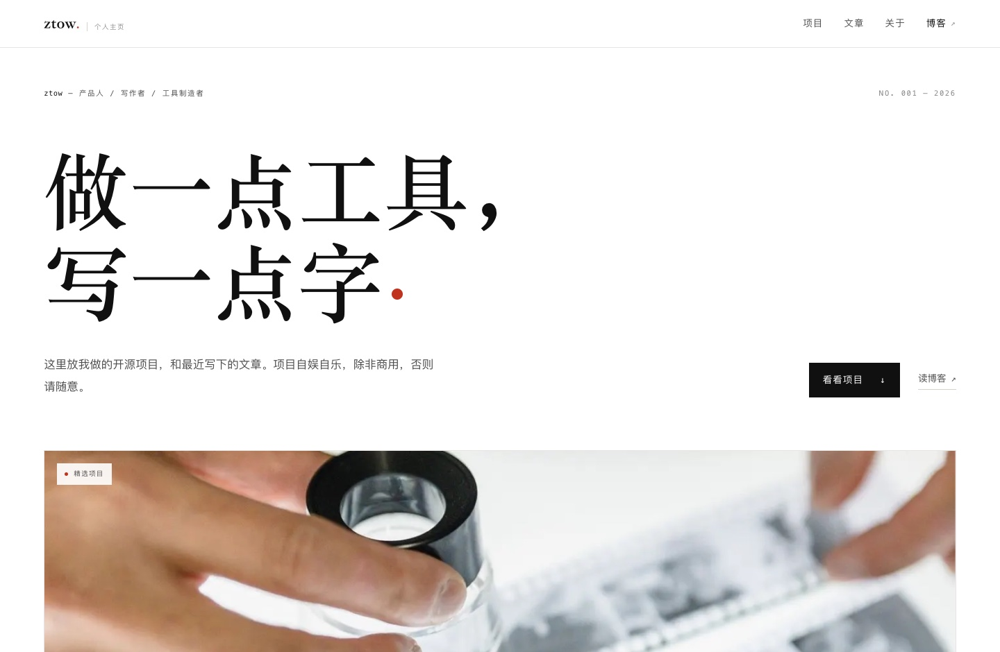
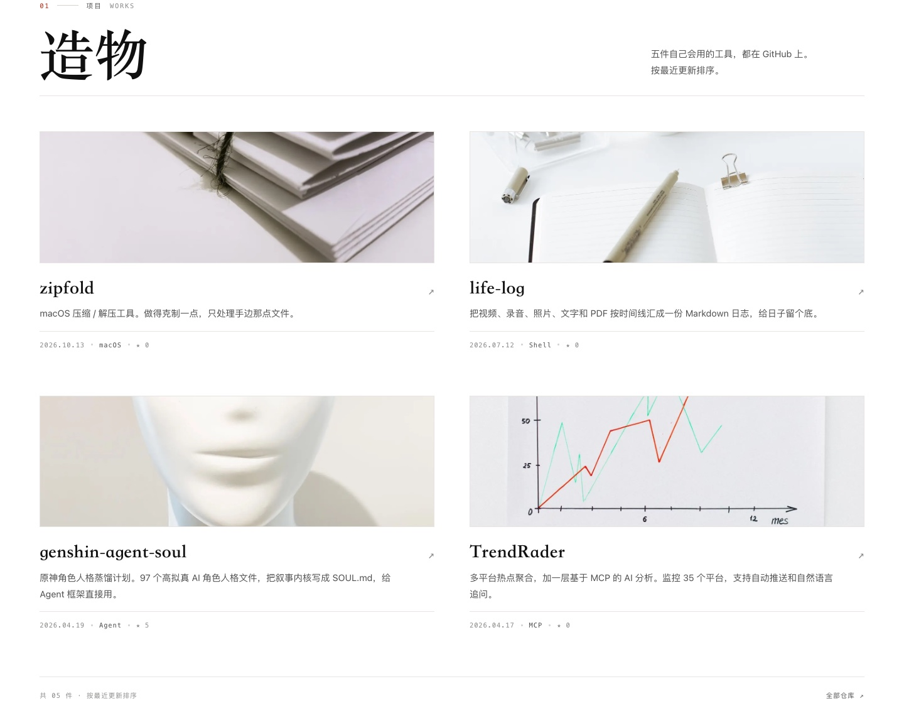

主页改完了。

上一版是暖白底、网格，还有跟着指针走的柔光；项目排成列表，右边挂一张 16:10 的缩略图。功能都在，看久了却有点像后台。

这回只想要一张白纸：纯白背景，黑色宋体，一条细线把内容分开。图片压成 3:1，像电影画幅，把视线留给文字。

## 改了什么

**版式**：顶部固定导航，第一屏只留标题、简介和两个入口。精选项目一张大图，其余四件排进两列网格。

**图片**：五张项目图全部换成真实摄影，从 Pexels 挑的，按项目内容对应——底片和放大镜给照片整理，捆扎的白纸给 zipfold，摊开的笔记本给 life-log，无五官的人偶给角色人格，手绘折线图给 TrendRader。统一裁成 3:1。

一开始是 2.35:1，排出来还是觉得不够扁，最后定在 3:1。宽一点，页面呼吸就顺一点。

**数据**：项目区读 GitHub，更新日期和星数自动变；文章区读 ztow.me 的 RSS，取最近十篇。两边都做了十分钟缓存和 ETag，接口出问题就显示页面里内置的列表，不会白屏。

**搜索**：补了 title、description、Open Graph、JSON-LD 和 favicon。旧站的标题是空的，这次一起修了。

## 长这样

项目区：

## 几件技术小事

还是单文件，没有构建步骤，GitHub Pages 直接托管。图片同时准备了 WebP 和 JPEG，用 `<picture>` 让浏览器自己挑。

项目数据只发一次请求，取五个仓库的更新时间和星数；文章列表的静态版本就是兜底，关掉 JavaScript 也能看。

页面上只写 ztow，邮箱留了一个链接。

主页是门面，博客是里屋。门面收拾干净，里屋照旧。

[ztow.github.io](https://ztow.github.io/)
