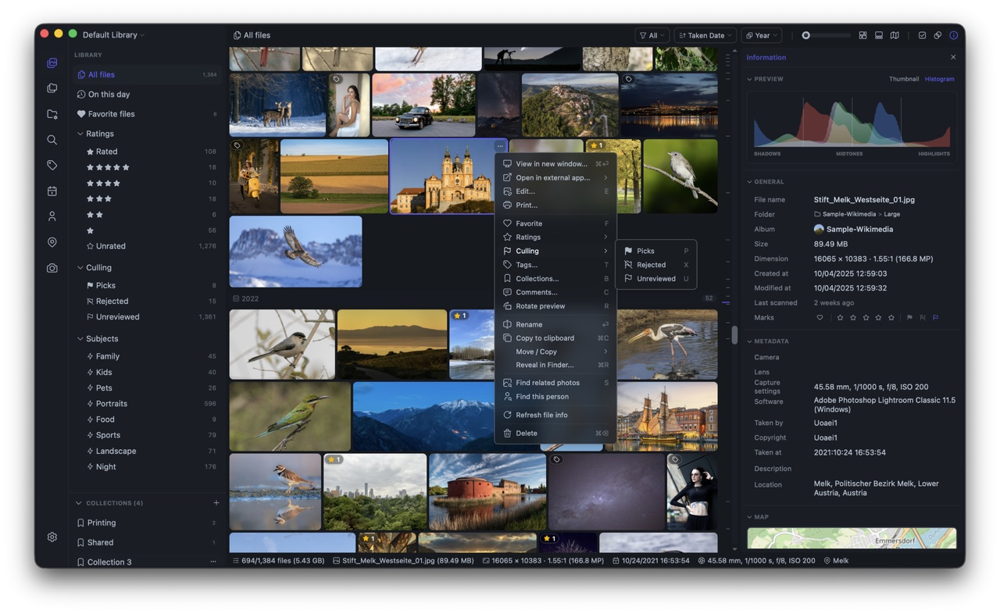

十几年的照片，散在几块移动硬盘里，按年份分目录，中间夹着从 iPhone 和安卓手机导出的批次。这类资料最尴尬：足够让 Finder 变成一个只能靠缩略图瞎翻的地方，又不够值得专门买一套专业图库软件。

macOS 自带的「照片」能解决浏览问题，代价是必须把它们全部导入自己的库。库是封闭的，照片在 Finder 里只剩一个包；想按原来的目录结构再拿出来，就得导出一次。我试过三次，每次都在进度条前放弃。

后来也试过 Lightroom、Eagle 这类工具，问题反过来了：功能都够，只是太重，为了一次「翻翻去年的照片」启动一个几 GB 的软件，不值。

## Lap

Lap 是这个位置上目前最合我意的一个：开源的本地照片管理器，Rust + Tauri 写的，不是套壳浏览器；macOS、Windows、Linux 都有。

最关键是它对文件的态度——不导入、不搬家。你选一个已有的文件夹，它原地索引，照片还是原来的照片，自己的目录结构原样保留。所以它不可能绑架你：哪天不想用了，删掉软件，文件一个都不少。

功能上没什么短板：60 多种格式，RAW 和 JPEG/HEIC 配对显示，iPhone 的实况照片和安卓的动态照片能播放；地图、拼图、内置编辑、查重、四宫格挑片都有；本地 AI 搜索完全离线，用自己的模型在机器上跑，输入一段描述就能按内容找图，还有相似图、主体分类和人脸聚类。界面是深色的，该藏的藏起来，翻照片的时候屏幕上除了照片没有别的。

作者是 julyx10，项目做得相当完整。

## 它没吃满这台机器

真正让我动手的是导入速度。

我的机器是 M5 Pro，15 个核。第一次把一整年的导出目录加进 Lap，四千多个文件，用了 150.8 秒，大约每分钟 1,700 个文件。这个数字本身不算离谱，让我在意的是另一组：整个过程 CPU 平均占用 243%，峰值 376%。

15 个核，跑满应该是 1,500%。也就是说这台机器三分之二的时间在等——等一件单线程的事做完，再去做下一件。

而这只是一年的量。库越大，这笔账越难看。

顺手翻了翻代码，问题不在算法，方向很清楚：任务一件一件串着做；读文件为了稳妥，选的是最保守的方式；而 Mac 照片库里最常见的几种文件形态，恰好都落在最慢的那条路径上；本地 AI 模型的推理则是单实例排队。

于是 fork 了一份，只改性能，功能、界面、数据格式一样不动。

## 改了四个方向

**视频元数据**：原来在扫描目录的循环里，遇到一个视频就启动一次外部工具去读它的时长和分辨率，读完才处理下一个文件。现在改成后台预取——目录还没扫完，视频信息已经在另一个线程池里准备好了，扫描循环不再等它。

**动态照片检测**：安卓的动态照片是一张 JPEG 后面接一段视频，判断依据是文件尾部的两个字节。问题是这种相册里大部分 JPEG 的尾部并不是那两个字节，于是一张图要被完整读两遍才能下结论。改成内存映射，按页读取需要看的那部分，不再整份拷贝进内存。

**Apple 的实况照片标识**：实况照片的图片和视频靠一段写在文件头的标识串起来。原来的做法是把每张图开头 128 KB 转成文本再去找，现在是直接在原始字节上找。相册里几乎每张图都要走这一遍。

**本地 AI 模型**：语义搜索用的模型原来只有一个实例，一队图片排着队一张一张过。改成几个会话并行推理；顺带把发布版本的编译选项从「优先体积」换成「优先速度」——前者是给分发用的，后者才是给自己用的。

## 结果

同一台机器、同一个目录：

| | 原版 | 现在 |
| --- | --- | --- |
| 首次导入 | 150.8 秒 | 65.4 秒 |
| 速度 | 30 个/秒 | 65 个/秒 |
| CPU 平均 | 243% | 555% |
| CPU 峰值 | 376% | 735% |

结果也没有打折：测试目录里的文件全部索引，缩略图 4,213 张（与原版数量一致），3,859 条用于搜索的特征数据，动态照片误判 0 条。索引和缩略图我逐条比对过。

中间还有一轮反复：把扫描从 63 秒压到 43 秒之后，总时间几乎没变。因为瓶颈换了地方——扫描跑完，缩略图和 AI 特征还在队列里排着，大约每秒 62 项，全部做完正好又是 65 秒。现在整条流水线是平衡的，扫描不再是短板。

再往下就是调模型并发和缩略图预算，大概还能省十几二十秒，但要拿内存和稳定性去换。到这里我觉得够了，停手。

## 关于这个分支

代码在 [ztow/lap-ztow](https://github.com/ztow/lap-ztow)，fork 自原作者 [julyx10/lap](https://github.com/julyx10/lap)，GPL-3.0 不变，功劳全部属于原作者。这个分支只做一件事：针对最新 macOS（Apple Silicon）做性能优化，其他平台的代码没有动，功能也没有加。

设置里的「关于」写清了来源，软件名改成 Lap-ztow，免得和自己机器上另一份安装混在一起。数据库位置没变，所以换过去之后原来的索引还在，不用重新导一遍。

如果你在 Mac 上也有一堆按年份散落的照片目录，先去试试上游的 Lap；如果你正好也是 Apple Silicon，库在几万个文件这个量级，可以直接用我这个分支。
